<p align="center">
  
</p>

<h1 align="center">WorkTime Tracker</h1>

<p align="center">
  Трекер рабочего времени для Windows: вводите периоды строкой <code>0900 1800 созвон</code> — и сразу видите статистику.
</p>

<p align="center">
  <a href="https://github.com/z1ec/RDN-time-tracker/actions/workflows/ci.yml"></a>
  <a href="https://github.com/z1ec/RDN-time-tracker/releases/latest"></a>
  
  
  
  <a href="LICENSE"></a>
</p>

<p align="center">
  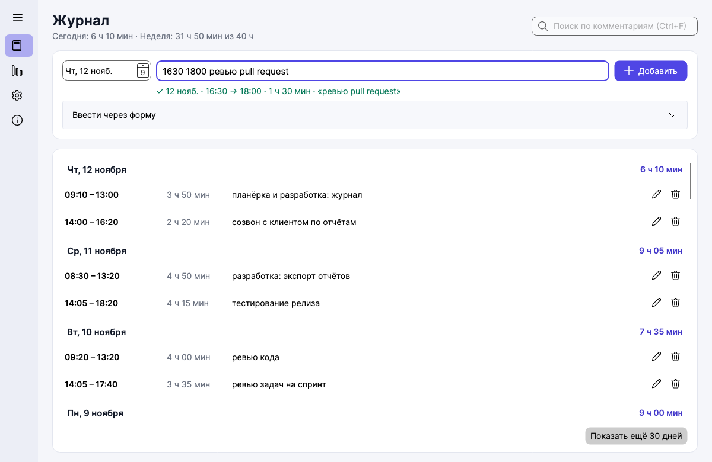
</p>

<table>
  <tr>
    <td>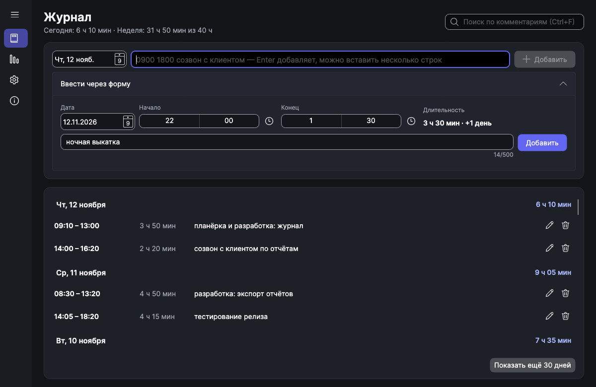</td>
    <td>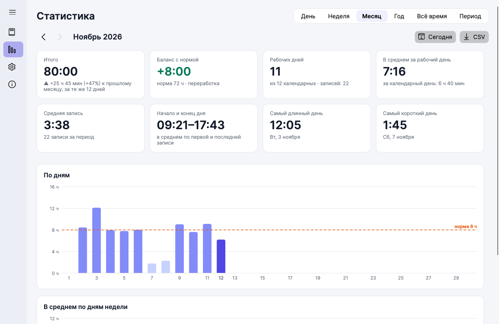</td>
  </tr>
  <tr>
    <td>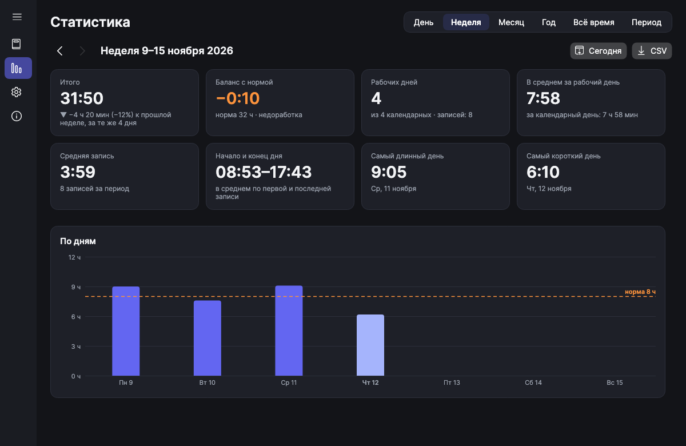</td>
    <td>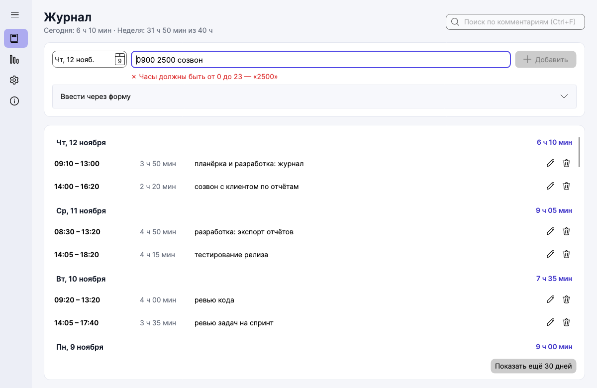</td>
  </tr>
</table>

## Возможности

- ⚡ **Быстрый ввод одной строкой:** `0900 1800`, `9:05-13:40 ревью`, `15.03 0900 1800 отчёт`, `2200 0200` (ночная смена), `0900 сейчас`. Живой предпросмотр и понятные ошибки прямо под полем.
- 📋 **Вставка нескольких строк сразу** — каждая строка становится записью; если хоть одна строка с ошибкой, не добавляется ничего.
- 🗓️ **Форма** с выбором даты и времени — для тех, кто любит мышь; правила те же.
- 🚫 **Без пересечений:** запись не может наложиться на другую, даже через полночь.
- ✏️ **Редактирование и комментарии**, поиск по комментариям с `Ctrl+F` (регистр не важен, кириллица тоже).
- ↩️ **Удаление без «Вы уверены?»** — вместо этого «Отменить» и `Ctrl+Z`.
- 📊 **Статистика** за день, неделю, месяц, год, всё время и любой период: итого, средние, норма и переработка, сравнение с прошлым периодом, графики, тепловая карта года.
- 📤 **Экспорт в CSV**, который русский Excel открывает без настроек.
- 💾 **Данные — у вас:** один файл SQLite, автоматические резервные копии, портативный режим. Без интернета, телеметрии и прав администратора.
- 🌗 **Светлая и тёмная темы**, иконки Fluent, шрифт Inter.

## Быстрый старт

1. Скачайте `WorkTimeTracker-vX.Y.Z-win-x64.exe` со страницы [Releases](https://github.com/z1ec/RDN-time-tracker/releases/latest).
2. Запустите. Установка и .NET не нужны — это один самодостаточный exe (~50 МБ).
3. Введите `0900 1800 планёрка` и нажмите `Enter`.

> **Windows SmartScreen** может показать «Система Windows защитила ваш компьютер». Exe не подписан платным сертификатом издателя, а у новой программы ещё нет «репутации» — поэтому так. Нажмите **«Подробнее» → «Выполнить в любом случае»**. Проверить файл можно по `SHA256SUMS.txt` из релиза: `Get-FileHash .\WorkTimeTracker-*.exe`.

## Как пользоваться

Строка быстрого ввода: `[дата] начало конец [комментарий]`.

| Ввод | Что получится |
|---|---|
| `0900 1800` | сегодня 09:00–18:00, 9 ч |
| `900 1800`, `9 18`, `09:00 18:00` | то же самое |
| `9:05-13:40`, `0900 — 1800` | разделитель — пробел или тире (`-`, `–`, `—`) |
| `0900 1800 созвон с клиентом` | всё после конца — комментарий |
| `2200 0200` | ночная смена 4 ч, относится к дате начала |
| `0000 2400` | целые сутки |
| `15.03 0900 1800 отчёт` | 15 марта (если дата ещё не наступила в этом году — прошлого года) |
| `15.03.2025 0900 1800` | конкретная дата |
| `0900 сейчас` | с 9:00 до текущего времени |

Без даты берётся дата, выбранная слева от поля (по умолчанию — сегодня). Время с точкой (`09.30`) не поддерживается — точка означает дату. Полные правила и тексты ошибок — в [docs/INPUT_FORMAT.md](docs/INPUT_FORMAT.md).

<details>
<summary><b>Горячие клавиши</b></summary>

| Клавиши | Действие |
|---|---|
| `Enter` | добавить запись из поля быстрого ввода |
| `Shift+Enter` | новая строка в поле (несколько записей сразу) |
| `Esc` | очистить поле / закрыть диалог |
| `Del` | удалить выбранные записи (`Ctrl`/`Shift`+клик — выбрать несколько) |
| `Ctrl+Z` | отменить последнее удаление |
| `Ctrl+F` | поиск по комментариям |
| `Ctrl+1` … `Ctrl+4` | Журнал · Статистика · Настройки · О программе |
| двойной клик по записи | редактировать |

</details>

## Статистика

- **Итого** и сравнение с прошлым периодом (для текущего — за то же число дней: «Пн–Чт» против «Пн–Чт»).
- **Баланс с нормой:** дневная норма (по умолчанию 8 ч) × рабочие дни (по умолчанию Пн–Пт) → переработка или недоработка.
- **Рабочие дни**, **среднее** за рабочий и календарный день, **средняя запись**, **среднее начало и конец дня**, **самый длинный и короткий день**.
- **Графики:** по дням с линией нормы, по месяцам, среднее по дням недели, тепловая карта года.

Точные формулы — в [docs/STATISTICS.md](docs/STATISTICS.md).

<details>
<summary><b>Ещё скриншоты</b></summary>

| | |
|---|---|
| 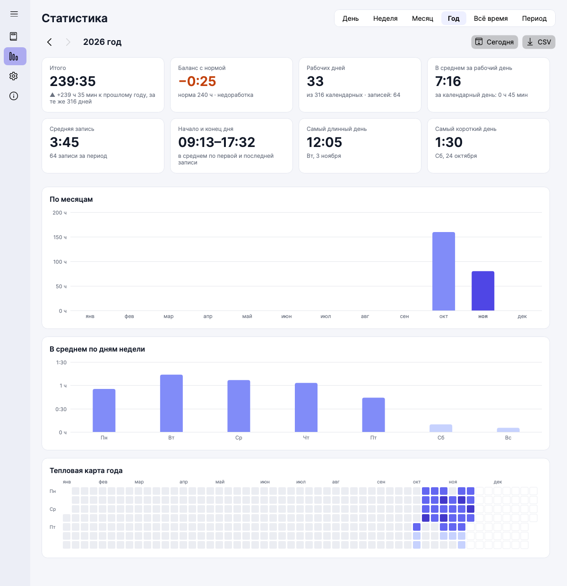 | 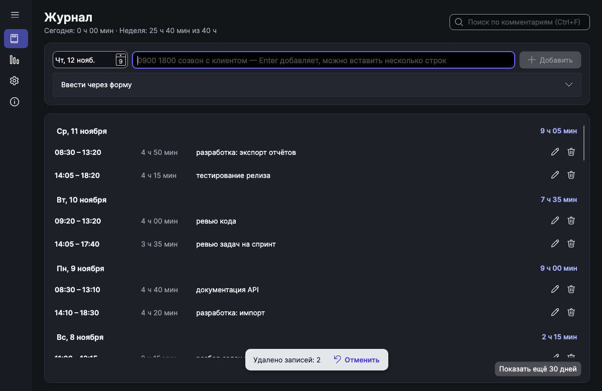 |
| 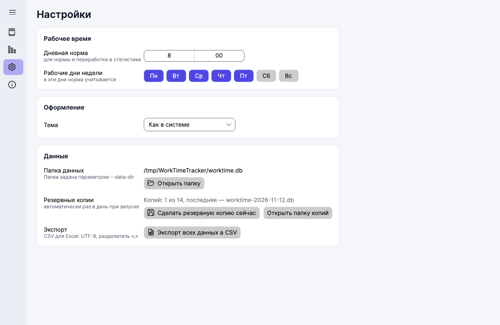 | 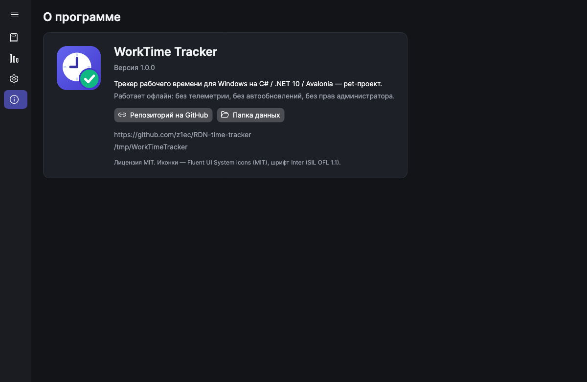 |

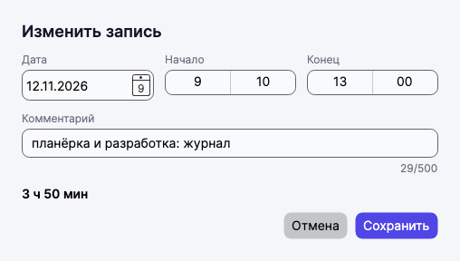

</details>

## Где хранятся данные

- **По умолчанию:** `%LOCALAPPDATA%\WorkTimeTracker\worktime.db` — путь видно в «Настройках» и «О программе».
- **Резервные копии:** раз в день при запуске и по кнопке в настройках — `backups\worktime-YYYY-MM-DD.db`, хранятся 14 последних. Как восстановить — в [docs/DATA_MODEL.md](docs/DATA_MODEL.md#ручное-восстановление-из-копии).
- **Портативный режим:** положите рядом с exe пустой файл `portable.txt` — данные будут в папке `data` рядом с программой (удобно для флешки).
- **Своя папка:** `WorkTimeTracker.exe --data-dir D:\Work\time`.
- Изменения сохраняются сразу, кнопки «Сохранить» нет. Повреждённый файл БД программа никогда не удаляет и не пересоздаёт сама.

## Технологии

| Что | Зачем |
|---|---|
| **.NET 10 (LTS)**, C# 14 | поддержка до ноября 2028 ([ADR-0008](docs/adr/0008-dotnet-10-lts.md)) |
| **Avalonia UI 12** + Fluent + Inter | кроссплатформенный XAML: разработка и UI-тесты на macOS/Linux, релиз под Windows ([ADR-0001](docs/adr/0001-avalonia.md)) |
| **CommunityToolkit.Mvvm** | MVVM на source generators, без рефлексии |
| **SQLite** (`Microsoft.Data.Sqlite`) + **Dapper** | один файл, транзакции, WAL, быстрые выборки ([ADR-0002](docs/adr/0002-sqlite-dapper.md)) |
| **Microsoft.Extensions.DependencyInjection** | композиция сервисов, общая для UI и self-test |
| **TimeProvider** / FakeTimeProvider | детерминированные «сегодня» и «сейчас» в тестах |
| **Serilog** | журнал программы с ротацией по дням |
| свои графики на `DrawingContext` | ноль зависимостей и проблем совместимости ([ADR-0005](docs/adr/0005-custom-charts.md)) |
| **xUnit v3**, **Avalonia.Headless**, coverlet | юнит-, интеграционные и headless UI-тесты, покрытие |
| **GitHub Actions** | тесты на Linux, сборка и self-test exe на Windows, релиз по тегу |

## Архитектура

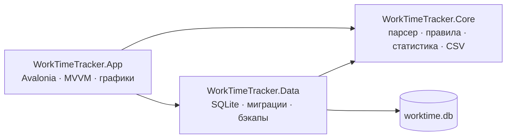

```
src/
  WorkTimeTracker.Core/   домен без зависимостей: модель времени, QuickEntryParser, EntryValidator,
                          StatisticsCalculator, PeriodNavigator, RuFormat, CsvExporter, EntryService
  WorkTimeTracker.Data/   DataPaths, Migrator + Migrations/*.sql, EntryRepository, SettingsStore, BackupService
  WorkTimeTracker.App/    Program (CLI), Views, ViewModels, Controls (BarChart, YearHeatmap), Services, Styles
tests/                    Core.Tests · Data.Tests · App.Tests (ViewModel, headless UI, скриншоты)
tools/IconGen/            генератор иконки на SkiaSharp
scripts/                  build · test · run · screenshots · publish-win · package-release · release-notes
```

Подробно — [docs/ARCHITECTURE.md](docs/ARCHITECTURE.md).

## Как это устроено внутри

<details>
<summary><b>Грамматика быстрого ввода</b></summary>

`QuickEntryParser` — ручной токенизатор с позициями: дата (только первым словом и только с точкой), время начала, разделитель (пробелы и/или одно тире), время конца, остаток — комментарий. Каждая ошибка знает свой фрагмент строки, поэтому сообщение звучит как «Часы должны быть от 0 до 23 — «2500»», а не «ошибка формата». Точка зарезервирована для даты — так `09.30` не путается с половиной десятого. Если комментарий начинается с чего-то похожего на время (`0900 1300 1400 1800`), парсер подсказывает ввести второй интервал отдельной строкой. Таблица из 71 примера — прямо в тестах.
</details>

<details>
<summary><b>Модель времени и ночные смены</b></summary>

Запись — это дата начала и минуты от её полуночи: `start_min` 0…1439, `end_min` до 2880. `2200 0200` → `1320…1560`. Длительность — разность, ночная смена целиком относится к дате начала, а пересечения проверяются в «абсолютных минутах» (`DayNumber × 1440 + минуты`), поэтому смена 22:00–02:00 пересекается с записью следующего утра 01:00–03:00. Часовые пояса сознательно не учитываются ([ADR-0003](docs/adr/0003-time-model.md)).
</details>

<details>
<summary><b>Мягкое удаление с отменой</b></summary>

Удаление ставит `deleted_at`, а не стирает строку. Уведомление «Удалено записей: 3 · Отменить» живёт 8 секунд, `Ctrl+Z` работает, пока после удаления не было других изменений — так отмена не может создать пересечение. Через 30 дней удалённое вычищается при запуске ([ADR-0004](docs/adr/0004-soft-delete-undo.md)).
</details>

<details>
<summary><b>Миграции и бэкапы</b></summary>

SQL-скрипты `Migrations/NNNN_*.sql` встроены в сборку; каждая миграция и запись в `schema_version` — одна транзакция. Перед миграциями делается копия БД через SQLite Backup API. Если файл повреждён или создан более новой версией — программа показывает путь к нему и ничего не трогает.
</details>

<details>
<summary><b>Windows-exe с Mac и self-test настоящего exe в CI</b></summary>

Разработка велась на macOS, Windows-машины не было. Exe собирается кросс-публикацией (`win-x64`, self-contained, single-file, без trimming), а job `windows` в CI запускает **настоящий** `WorkTimeTracker.exe --self-test`: 14 проверок — от миграций и нативного SQLite до бэкапа и русских форматов — с отчётом в `self-test.log` и кодом выхода. Так ловятся проблемы упаковки нативных библиотек, которые не видны ни в одном тесте на macOS ([ADR-0006](docs/adr/0006-self-contained-single-file.md)).
</details>

<details>
<summary><b>Headless-скриншоты</b></summary>

Скриншоты в этом README сняты тестами: Avalonia Headless с настоящим Skia и шрифтом Inter, `FakeTimeProvider` с фиксированным «сегодня» и ~6 недель демо-данных во временной БД. `scripts/screenshots.sh` перегенерирует их за несколько секунд — ими же проверялась вёрстка в обеих темах.
</details>

<details>
<summary><b>Свои графики</b></summary>

`BarChart` и `YearHeatmap` — около 350 строк на `DrawingContext`: «красивая» шкала часов, пунктир нормы, приглушённые выходные, подсказки с точным значением, цвета из ресурсов темы. Никаких сторонних библиотек, которые могли бы отстать от Avalonia 12 ([ADR-0005](docs/adr/0005-custom-charts.md)).
</details>

## Сборка из исходников

Нужен **.NET 10 SDK** (macOS / Windows / Linux; на Linux для Skia — `libfontconfig1`). Подробно — [docs/DEVELOPMENT.md](docs/DEVELOPMENT.md).

```bash
git clone https://github.com/z1ec/RDN-time-tracker.git && cd RDN-time-tracker
scripts/build.sh                 # сборка (Release, предупреждения = ошибки)
scripts/run.sh                   # запуск (на macOS/Linux тоже работает)
scripts/test.sh                  # все тесты + покрытие (порог Core 90%)
scripts/screenshots.sh           # скриншоты → docs/images
scripts/publish-win.sh 1.0.0     # Windows-exe → artifacts/win-x64/WorkTimeTracker.exe
```

**Выпуск релиза:** секция версии в `CHANGELOG.md` → `git tag vX.Y.Z && git push origin vX.Y.Z` → GitHub Actions соберёт exe, zip и `SHA256SUMS.txt` и опубликует релиз ([docs/BUILD_AND_RELEASE.md](docs/BUILD_AND_RELEASE.md)).

## 🤖 Как создавался проект

Проект целиком создан **агентом Claude Code автономно** — по одному техническому заданию, без участия человека в процессе: от пустой папки до опубликованного релиза. Задание лежит дословно в [docs/ORIGINAL_PROMPT.md](docs/ORIGINAL_PROMPT.md), а ход работы — решения, ошибки, их исправления и результаты проверок по этапам — в [docs/DEVELOPMENT_LOG.md](docs/DEVELOPMENT_LOG.md).

Немного цифр (на момент выпуска v1.0.0): **14 коммитов** за **один день** (9 ноября 2026), **338 автотестов** (+10 тестов-скриншотов), покрытие строк ядра **99%**, около **5 900 строк** кода приложения и **3 400 строк** тестов, 8 ADR и 11 документов в `docs/`.

## Roadmap и лицензия

Планы и известные ограничения — [docs/ROADMAP.md](docs/ROADMAP.md). Карта всей документации — [docs/README.md](docs/README.md).

Лицензия — [MIT](LICENSE). Иконки — [Fluent UI System Icons](https://github.com/microsoft/fluentui-system-icons) (MIT), шрифт — [Inter](https://rsms.me/inter/) (SIL OFL 1.1).
