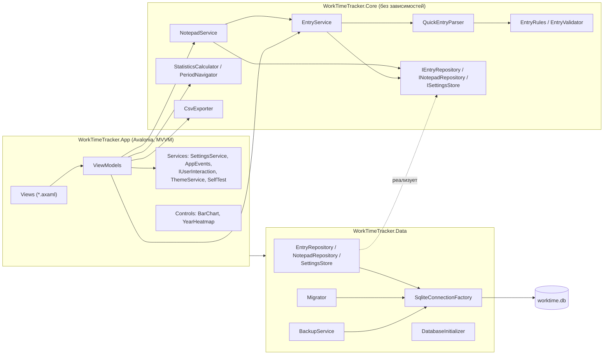
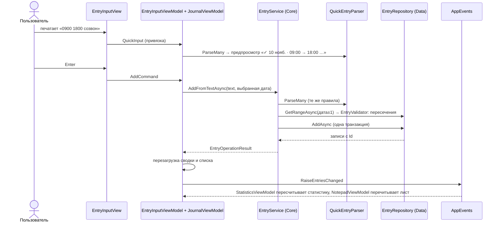

# Архитектура

WorkTime Tracker — desktop-приложение на .NET 10 и Avalonia 12 с тремя слоями: **Core** (домен) ← **Data** (SQLite) ← **App** (UI, MVVM). Вся бизнес-логика — в Core и покрыта тестами; в code-behind — только визуальные вещи (фокус, маршрутизация клавиш).

## Слои и зависимости



| Проект | Ответственность | Зависит от |
|---|---|---|
| `WorkTimeTracker.Core` | модели, разбор быстрого ввода, правила и пересечения, статистика, периоды, форматирование по-русски, CSV, интерфейсы хранилища, сценарии `EntryService` и `NotepadService` | — |
| `WorkTimeTracker.Data` | пути к данным, соединения, миграции, репозитории записей и блокнота, настройки, бэкапы, подготовка БД при запуске | Core, Microsoft.Data.Sqlite, Dapper |
| `WorkTimeTracker.App` | окно, экраны, ViewModel-и, свои графики, DI, логи, CLI-режимы `--version` / `--self-test` / `--data-dir` | Core, Data, Avalonia, CommunityToolkit.Mvvm, M.E.DependencyInjection, Serilog |
| `tools/IconGen` | генератор иконки (SkiaSharp) | SkiaSharp |

## Поток данных: быстрый ввод



Поле ввода и форма — общий контрол `EntryInputView` / `EntryInputViewModel` для «Журнала» и «Блокнота» (F8.2). Вкладка-владелец передаёт ему только способ сохранения и обработчик «добавлено».

## Блокнот и поток событий (F8)

Блокнот — листы и привязки поверх обычных записей (ADR-0009, `docs/DATA_MODEL.md`). Запись, добавленная в блокноте, проходит тот же путь, что и в журнале; отличается только последний шаг — вставка записи вместе с привязкой к листу.

```mermaid
sequenceDiagram
    actor U as Пользователь
    participant NV as NotepadViewModel
    participant NS as NotepadService (Core)
    participant S as EntryService (Core)
    participant NR as NotepadRepository (Data)
    participant E as AppEvents
    participant J as JournalViewModel
    participant ST as StatisticsViewModel
    U->>NV: «0900 1800 задача» + Enter (EntryInputViewModel)
    NV->>NS: AddFromTextAsync
    NS->>S: AddFromTextAsync(text, дата, insert: NotepadRepository.AddEntriesAsync)
    S->>S: разбор, правила, пересечения со ВСЕМИ записями
    S->>NR: AddEntriesAsync — одна транзакция:<br/>лист (если нет) + entries + notepad_items
    NV->>NV: LoadAsync: плашка, список, архив
    NV->>E: RaiseEntriesChanged(отправитель — блокнот)
    E-->>J: перезагрузка; отмена удаления сброшена
    E-->>ST: пересчёт статистики
    Note over NV,NR: ✕, «Очистить всё», «Удалить из архива» меняют только<br/>notepad_items / notepad_sheets — событие не поднимается,<br/>записи и статистика не затрагиваются
    U->>J: удаляет или правит запись в «Журнале»
    J->>E: RaiseEntriesChanged(отправитель — журнал)
    E-->>NV: LoadAsync: сумма и архив показывают новое состояние
```

- **Кто поднимает `EntriesChanged`:** «Журнал» — при добавлении, правке, удалении и отмене удаления; «Блокнот» — только при добавлении и правке (то есть когда меняются сами записи).
- **Кто слушает:** «Журнал» (кроме своих событий), «Блокнот» (кроме своих), «Статистика» (все).
- **Отмена** (`UndoToastViewModel`): у «Журнала» и «Блокнота» свои экземпляры; `Ctrl+Z` в `MainWindow` вызывает `MainWindowViewModel.ActiveUndo` — отмену активной вкладки (F8.20).

## Ключевые классы

| Класс | Где | Что делает |
|---|---|---|
| `TimeRange`, `WorkEntry`, `EntryDraft` | Core/Model | модель времени: минуты от начала даты записи, ночные смены (ADR-0003) |
| `QuickEntryParser` | Core/Parsing | грамматика быстрого ввода, ошибки с фрагментом (`docs/INPUT_FORMAT.md`) |
| `EntryRules` | Core/Validation | единые правила записи для быстрого ввода, формы и редактирования |
| `EntryValidator` | Core/Validation | запрет пересечений в абсолютных минутах (ADR-0007) |
| `EntryService` | Core/Services | сценарии: добавить из текста/формы, изменить, удалить, отменить удаление; делегат `EntryInserter` — чем сохранять проверенные записи |
| `NotepadSheet`, `NotepadSheetView` | Core/Model | лист блокнота и лист с его видимыми записями (F8) |
| `NotepadService` | Core/Services | сценарии блокнота: добавить (через `EntryService`), название, убрать/вернуть запись, очистить/вернуть лист, удалить/вернуть лист архива |
| `NotepadFormat` | Core/Formatting | тексты плашки и карточек архива |
| `PeriodNavigator`, `StatisticsCalculator` | Core/Statistics | периоды, ◀/▶, все показатели (`docs/STATISTICS.md`) |
| `RuFormat`, `DurationFormatter` | Core/Formatting | русские даты, «8 ч 05 мин», подписи периодов |
| `CsvExporter` | Core/Export | CSV для русского Excel |
| `DataPaths` | Data | папка данных: `--data-dir` → `portable.txt` → `%LOCALAPPDATA%` |
| `Migrator`, `DatabaseInitializer` | Data | миграции, автобэкап, очистка, понятные ошибки открытия БД |
| `EntryRepository`, `SettingsStore`, `BackupService` | Data | SQL через Dapper, настройки, копии через Backup API |
| `NotepadRepository` | Data | листы и привязки блокнота; запись + привязка одной транзакцией; очистка мусора |
| `AppComposition` | App/Services | регистрация зависимостей; `AddCoreServices` используется и UI, и self-test |
| `MainWindowViewModel` | App/ViewModels | навигация и последовательность запуска |
| `JournalViewModel`, `NotepadViewModel`, `StatisticsViewModel`, `SettingsViewModel`, `AboutViewModel` | App/ViewModels | экраны |
| `EntryInputViewModel` + `Views/EntryInputView` | App | быстрый ввод с предпросмотром и форма — общий контрол «Журнала» и «Блокнота» |
| `UndoToastViewModel` + `Views/UndoToastView` | App | уведомление «… · Отменить» на 8 с и команда отмены; по экземпляру на вкладку |
| `ArchiveSheetViewModel`, `Views/NotepadView` | App | карточка листа в архиве; вкладка «Блокнот» |
| `BarChart`, `YearHeatmap` | App/Controls | свои графики на `DrawingContext` (ADR-0005) |
| `SelfTest` | App/Services | режим `--self-test` для CI |

## Запуск приложения

1. `Program.Main`: культура `ru-RU` (`RuFormat.Culture`) для всего процесса; разбор аргументов. `--version` и `--self-test` выполняются без UI и завершают процесс.
2. `App.OnFrameworkInitializationCompleted`: `DataPaths` → Serilog (`logs\app-YYYYMMDD.log`) → глобальные обработчики ошибок → DI-контейнер → `MainWindow` с `MainWindowViewModel`.
3. `MainWindow.Opened` → `MainWindowViewModel.InitializeAsync`: `DatabaseInitializer` (папки → автобэкап → миграции → очистка удалённых записей и мусора блокнота старше 30 дней) → загрузка настроек → тема → загрузка журнала, блокнота и статистики. Если БД не открылась — диалог с путём и «Открыть папку», затем выход с кодом 2; данные не трогаются (F4.7).
4. Закрытие окна сохраняет его размер и положение (F4.8).

## MVVM-соглашения

- **CommunityToolkit.Mvvm**, source generators: `[ObservableProperty] public partial T Prop { get; set; }` (partial-свойства, без инициализаторов — значения задаются в конструкторе), `[RelayCommand]` для команд, `NotifyCanExecuteChangedFor` для доступности кнопок.
- **Compiled bindings** включены для всего проекта (`AvaloniaUseCompiledBindingsByDefault`), у каждого представления и шаблона — `x:DataType`. Ошибка в привязке — ошибка компиляции.
- ViewModel-и не знают про окна: диалоги, выбор файла, открытие папок и ссылок — через `IUserInteraction` (в тестах — `FakeUserInteraction`).
- Связь между экранами — `AppEvents.EntriesChanged` и `SettingsService.Changed`; экраны перезагружают свои данные сами.
- Code-behind содержит только визуальное: фокус поля ввода, Enter/Shift+Enter/Esc в поле быстрого ввода, Ctrl+F (фокус поиска), Ctrl+Z (отмена активной вкладки, с учётом фокуса в текстовом поле), двойной клик по строке, сохранение названия листа блокнота по Enter и при уходе со вкладки.
- Все интерактивные элементы имеют `AutomationProperties.Name` — для доступности и для поиска в headless-тестах.

## Зависимости и DI

`Microsoft.Extensions.DependencyInjection`, все сервисы и ViewModel-и — singleton (одно окно, один пользователь). `ValidateOnBuild = true` ловит ошибки регистрации при старте (и в self-test). `TimeProvider` регистрируется как зависимость: в приложении — `TimeProvider.System`, в тестах — `FakeTimeProvider`.

## Потоки и асинхронность

- `Microsoft.Data.Sqlite` выполняет запросы синхронно, поэтому `SqliteConnectionFactory.RunAsync` уносит каждую операцию в пул потоков; продолжения возвращаются в UI-поток через `SynchronizationContext` Avalonia. UI не блокируется.
- Повторные загрузки (быстрый ввод в поиск, переключение периодов) защищены счётчиком версии запроса: устаревший ответ отбрасывается.
- `SettingsService` сохраняет настройки строго по очереди (`SemaphoreSlim`) и всегда пишет самое свежее состояние.
- `ThemeService` меняет тему только из UI-потока (через `Dispatcher`).

## Обработка ошибок (F7.10)

| Источник | Что происходит |
|---|---|
| Ошибка ввода (парсер, правила, пересечение) | красный текст под полем или в диалоге; никаких модальных окон |
| БД не открывается | `DatabaseOpenException` → диалог с путём к файлу и «Открыть папку» → выход; файл не меняется |
| Ошибка ввода-вывода при экспорте/бэкапе | запись в лог + диалог «Не удалось …» |
| Необработанное исключение в UI | `Dispatcher.UIThread.UnhandledException`: лог + диалог «Что-то пошло не так» с кнопкой открытия папки логов; приложение продолжает работу |
| Исключение в фоновой задаче / домене | `TaskScheduler.UnobservedTaskException`, `AppDomain.UnhandledException` → лог |

Данные не теряются: каждое изменение уже записано в БД своей транзакцией.

## Дизайн

- **Тема:** Avalonia `FluentTheme` с палитрами `ColorPaletteResources`; акцентный цвет — **индиго** (`#4F46E5` в светлой теме, `#6366F1` в тёмной). По умолчанию тема следует системной; выбор — в настройках.
- **Шрифт:** Inter (`Avalonia.Fonts.Inter`). Размеры: заголовок экрана 24 SemiBold, заголовок блока 15 SemiBold, KPI 28 SemiBold, основной текст 14, вспомогательный 12.
- **Сетка и формы:** отступы кратны 8 (страница 24, карточки 16, промежутки 8/12/16), скругления карточек 12, контролов 8. Блоки — карточки (`Border.card`) на чуть более тёмном фоне страницы.
- **Цветовые токены** (`Styles/Theme.axaml`, светлая / тёмная): `PageBackground` `#F5F6FA` / `#131418`, `CardBackground` `#FFFFFF` / `#1E2028`, `CardBorder` `#E3E6EF` / `#2D303C`, `SubtleText` `#6B7280` / `#9CA3AF`, `AccentText` `#4338CA` / `#A5B4FC`, `Positive` `#047857` / `#34D399`, `Negative` (недоработка) `#C2410C` / `#FB923C`, `Error` `#DC2626` / `#F87171`, графики — оттенки индиго, линия нормы — оранжевая.
- **Иконки:** векторные `PathIcon` с геометрией Fluent UI System Icons (MIT), `Styles/Icons.axaml`. Иконка «Блокнот» — своя (лист со строками). Эмодзи и растровые картинки в интерфейсе не используются (кроме иконки приложения).
- **Состояния:** пустой журнал — «Пока нет записей — введите, например, 0900 1800 планёрка»; поиск без результатов — «Ничего не найдено…»; пустой период статистики — подпись под KPI; ошибки ввода — красным под полем; удаление — тёмное уведомление внизу списка с кнопкой «Отменить»; пустой блокнот — «Блокнот пуст — запишите время…», пустой архив — «Здесь появятся очищенные блокноты».
- **Окно:** стартовый размер 1200×780, минимальный 900×600; боковая панель навигации в компактном режиме (иконки, подписи — по кнопке меню).
- Вид проверяется headless-скриншотами в обеих темах (`scripts/screenshots.sh`, `docs/images/`).
