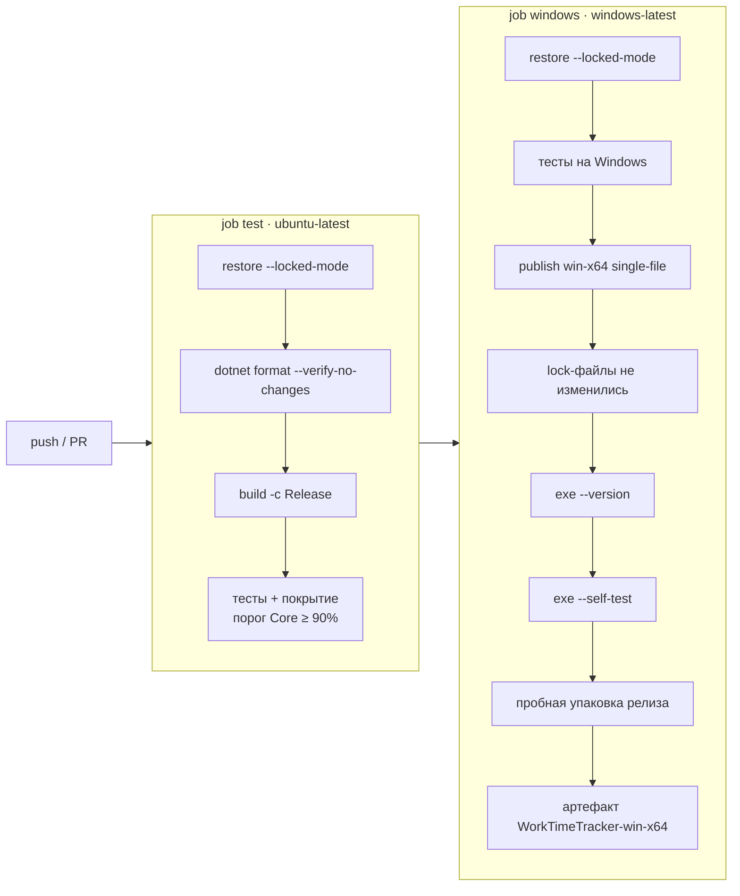

# Сборка, CI и выпуск релизов

## Как устроен CI

Два workflow в `.github/workflows/`. Версии actions: `checkout@v7`, `setup-dotnet@v6`, `upload-artifact@v7` (обновляет Dependabot раз в месяц, `.github/dependabot.yml`).

### `ci.yml` — на каждый push в `main` и PR



- Сводка покрытия по сборкам публикуется в `$GITHUB_STEP_SUMMARY` (`scripts/coverage_summary.py`).
- Результаты тестов (`.trx`, cobertura) — артефакт `test-results` (7 дней).
- Тесты запускаются и на `windows-latest` (файловые блокировки и пути там ведут себя иначе, чем на Linux/macOS). Упавшие тесты выводятся аннотациями (`scripts/annotate_test_failures.py`) — их видно на странице запуска и через публичный API без доступа к логам.
- Главная проверка — **запуск настоящего Windows-exe** в режиме `--self-test`: macOS не может запустить exe, а нативные библиотеки (SQLite, Skia, HarfBuzz) должны корректно распаковываться из single-file. Отчёт `self-test.log` печатается в лог job.
- `concurrency` отменяет устаревшие запуски той же ветки; `permissions: contents: read`.

### `release.yml` — на push тега `vX.Y.Z`

`windows-latest`: версия из тега → `restore --locked-mode` → тесты → `scripts/publish-win.sh X.Y.Z` → self-test exe → `scripts/package-release.sh vX.Y.Z` → `scripts/release-notes.sh X.Y.Z` → `gh release create` с файлами:

| Файл | Что это |
|---|---|
| `WorkTimeTracker-vX.Y.Z-win-x64.exe` | сам exe (single-file, self-contained) |
| `WorkTimeTracker-vX.Y.Z-win-x64.zip` | exe + LICENSE |
| `SHA256SUMS.txt` | SHA-256 обоих файлов (`sha256sum -c SHA256SUMS.txt`) |

Заметки к релизу — секция `## [X.Y.Z]` из `CHANGELOG.md` плюс подсказка про SmartScreen. `permissions: contents: write`.

## Команда публикации

Одна и та же в `scripts/publish-win.sh`, `ci.yml` и `release.yml`:

```bash
dotnet publish src/WorkTimeTracker.App/WorkTimeTracker.App.csproj -c Release -r win-x64 \
  --self-contained true -p:PublishSingleFile=true -p:IncludeNativeLibrariesForSelfExtract=true \
  -p:EnableCompressionInSingleFile=true -p:PublishTrimmed=false -p:DebugType=none \
  -p:Version=$VERSION -o artifacts/win-x64
```

Без trimming и AOT (ADR-0006). Работает и на macOS/Linux — exe собирается за несколько секунд. Нативные `.pdb` SkiaSharp/HarfBuzz исключаются таргетом `RemovePdbFromPublish` в `WorkTimeTracker.App.csproj`.

### Lock-файлы

`RestorePackagesWithLockFile=true`, lock-файлы коммитятся, CI восстанавливает пакеты в `--locked-mode`. Два нюанса, из-за которых упал первый CI-запуск (см. `docs/DEVELOPMENT_LOG.md`, этап 1):
- `EnableSingleFileAnalyzer=false` (в `Directory.Build.props`) — иначе публикация добавляет в lock-файлы пакет `Microsoft.NET.ILLink.Tasks` с версией установленного SDK;
- `RuntimeIdentifiers=win-x64` у App, Core и Data — иначе `-r win-x64` меняет набор RID в lock-файлах.

CI проверяет, что публикация не изменила lock-файлы (`git diff --exit-code -- '**/packages.lock.json'`).

## Как выпустить новую версию

1. Убедитесь, что `main` зелёный: последний запуск CI — ✅.
2. В `CHANGELOG.md` переименуйте `## [Unreleased]` в `## [X.Y.Z] - ГГГГ-ММ-ДД`, над ним добавьте пустую `## [Unreleased]`, внизу обновите ссылки сравнения.
3. Проверьте заметки локально: `scripts/release-notes.sh X.Y.Z`.
4. Коммит `chore(release): vX.Y.Z` и push в `main`; дождитесь зелёного CI.
5. Тег и push тега:
   ```bash
   git tag vX.Y.Z
   git push origin vX.Y.Z
   ```
6. Дождитесь `release.yml` (`gh run watch`), затем проверьте:
   ```bash
   gh release view vX.Y.Z      # exe, zip и SHA256SUMS.txt на месте
   ```
7. Скачайте exe и пройдите чек-лист ручной проверки из `docs/DEVELOPMENT.md`.

Версия в сборке берётся из тега (`-p:Version=X.Y.Z`) и показывается в «О программе» и `--version`. Значение `<Version>` в `Directory.Build.props` — версия по умолчанию для локальных сборок; обновляйте его вместе с релизом.

## SmartScreen и неподписанный exe

Exe не подписан сертификатом издателя (подпись кода — в ROADMAP). Поэтому при первом запуске скачанного файла Windows SmartScreen показывает «Система Windows защитила ваш компьютер». Это ожидаемо для любой новой неподписанной программы: SmartScreen доверяет файлам с репутацией (много скачиваний) или с подписью. Пользователю: «Подробнее» → «Выполнить в любом случае». Целостность файла можно проверить по `SHA256SUMS.txt`:

```powershell
Get-FileHash .\WorkTimeTracker-vX.Y.Z-win-x64.exe -Algorithm SHA256
```

## Если CI упал

| Шаг | Частая причина | Что делать |
|---|---|---|
| `restore --locked-mode` | изменили пакеты, но не обновили lock-файлы; или SDK добавил неявный пакет | `dotnet restore --force-evaluate`, закоммитить `packages.lock.json`; проверить `EnableSingleFileAnalyzer`/`RuntimeIdentifiers` |
| `dotnet format --verify-no-changes` | не отформатирован код | `dotnet format`, закоммитить |
| `build` | предупреждение (они — ошибки) или ошибка привязки XAML | исправить; ошибки compiled bindings указывают строку в `.axaml` |
| тесты | регрессия; на Linux — нет `libfontconfig1` для Skia | `scripts/test.sh` локально; логи — артефакт `test-results` |
| порог покрытия | новый код Core без тестов | дописать тесты (`scripts/test.sh` печатает таблицу) |
| self-test exe | нативная библиотека не распаковалась, ошибка DI, миграции | в логе job — содержимое `self-test.log` со строкой `FAIL`; воспроизвести: `scripts/publish-win.sh` и запуск exe на Windows с `--self-test` |
| `release-notes.sh` | нет секции `[X.Y.Z]` в CHANGELOG | добавить секцию, перевыпустить тег (удалить тег локально и на GitHub, создать заново) |

Посмотреть упавший запуск: `gh run list --limit 5`, `gh run view <id> --log-failed`.
